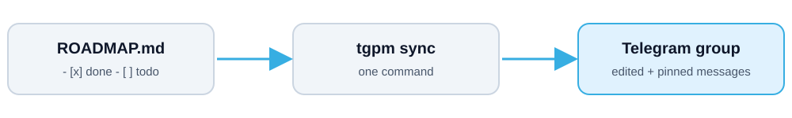

<div align="center">


<br>

**English** · [فارسی](README.fa.md)


[🌐 Website](https://jahaniwww.com) · [📣 Telegram channel](https://t.me/tarfandoonchannel)

</div>

---

## ✨ What is tgpm?

**tgpm** keeps a project's roadmap, weekly plan and announcements inside a Telegram group, so a developer and a project manager (or a client) can follow progress in one place, with no other tool.

<div align="center">

</div>

You write the roadmap as a normal Markdown checklist in your repository. After every change you run one command and the Telegram messages update themselves.

## 🚀 Features

| | Feature | Details |
|---|---|---|
| 🗺 | **Roadmap topic** | One message per week with a progress bar and ✅/⬜ per task. Edited in place, pinned. |
| 📅 | **Next-week plan** | Goals of the coming week plus what is still open. Only the newest plan stays pinned. |
| ⏭ | **Auto-advance** | When every task of the week is ticked, the next roadmap and plan are posted and pinned. |
| 📣 | **Updates topic** | Announcements and files with `tgpm post`, only when you send them. |
| 🌍 | **Two languages** | Messages in English or Persian, with Gregorian, Jalali or both dates. |
| 🤖 | **AI agent ready** | `tgpm agent install` teaches Claude Code, Codex, Cline, Cursor and Gemini CLI to use it. |
| 📦 | **Zero dependencies** | Standard library only, plus a single-file `tgpm.exe` for Windows. |

## 👀 What it looks like

Output of `tgpm week 1` (a message in your Telegram topic):

```text
🗺 Week 1: Foundation
Progress: 1 of 3 tasks (33%)
▰▰▰▱▱▱▱▱▱▱

✅ Set up the repository and CI
⬜ Write the first working version of the core feature
⬜ Write tests for the core feature

Week output: a working core feature with tests

📅 Last updated: 7 November 2026

#roadmap #week1 #MyApp
```

## ⚡ Quick start

### 1. Set up Telegram (once, ~5 minutes)

1. Open **@BotFather** → `/newbot` → copy the **token**.
2. Create a group (or use an existing one) and add the bot.
3. For one topic per section, turn on **Topics** in the group settings. Without topics tgpm still works and posts to the main chat.
4. Make the bot an **admin** with **Pin messages** and, if topics are on, **Manage topics**.
5. Find the group id (like `-1001234567890`): forward a group message to **@RawDataBot**.

> [!IMPORTANT]
> **Keep the token secret.** It lives only in `.env`, which `tgpm init` adds to `.gitignore`. tgpm never prints it, logs it or writes it into messages. If it leaks, run `/revoke` in @BotFather.

### 2. Run it

```powershell
# in your project folder (tgpm.exe, or: python -m tgpm ...)
tgpm init --name "My App" --lang en --calendar gregorian   # tgpm.json, .env, ROADMAP.md, .gitignore
# put TELEGRAM_BOT_TOKEN and TELEGRAM_CHAT_ID into .env, then:
tgpm check                 # verifies token, group, topics and the bot's rights
tgpm week 1 --dry-run      # preview the message (sends nothing)
tgpm week 1                # post (and pin) the roadmap of week 1
tgpm plan 2                # post (and pin) the plan of week 2
# ... work, tick tasks in ROADMAP.md ...
tgpm sync                  # edit every posted message; post the next week when this one is done
tgpm post --text "Release candidate is ready" --pin
tgpm post --document report.pdf --text "Weekly report"
tgpm status                # progress in the terminal, sends nothing
```

> [!TIP]
> Run `tgpm sync` after every change to `ROADMAP.md`. A git hook or CI step works well.

### 3. The roadmap file

```markdown
## Week 1: Foundation
- [x] Set up the repository and CI
- [ ] First working version of the core feature
- **Checkpoint 1: Friday**              (optional, shown in the plan)
- **Output:** a working core feature    (optional)

## Week 2: Launch
- [ ] ...
```

A heading `## Week N: ...` (also `Sprint`, `Phase`, `Milestone`, or Persian `## هفته N: ...`) starts a week. `- [ ]` and `- [x]` lines are its tasks.

## 🤖 Use it from AI coding agents

```powershell
tgpm agent install            # auto-detects Claude Code, Codex, Cline, Cursor, Gemini CLI
tgpm agent install all        # or name them: claude codex cline cursor gemini
tgpm agent install --global   # for your user instead of only this project
tgpm agent install --uninstall
```

It writes each tool's own format: a skill and `/tgpm-sync` command for Claude Code (plus a `.claude-plugin`), a marked block in `AGENTS.md` (Codex) and `GEMINI.md`, `.clinerules/tgpm.md` (Cline) and `.cursor/rules/tgpm.mdc` (Cursor). Re-running updates in place and keeps your own text. The agent is told never to read `.env`.

## 📖 Commands

| Command | What it does |
|---|---|
| `tgpm init` | Creates `tgpm.json`, a `.env` template, a sample `ROADMAP.md` and `.gitignore` entries. Never overwrites without `--force`. |
| `tgpm check` | Checks token, group, topics and the bot's admin rights. |
| `tgpm week N [--dry-run]` | Posts or edits the roadmap message of week N (pinned on first post). |
| `tgpm plan N [--dry-run]` | Posts or edits the plan message of week N; older plans are unpinned. |
| `tgpm sync` | Edits all posted messages; advances when the current week is fully ticked. |
| `tgpm post` | Sends a **new** message or file to a topic (`--topic`, `--text`, `--file`, `--document`, `--pin`, `--raw-html`, `--dry-run`). |
| `tgpm status` | Prints progress from the roadmap file. |
| `tgpm agent install` | Installs tgpm instructions for AI coding agents. |

Global option: `--dir <folder>` (default: current folder; `tgpm.json` is searched upwards).

## ⚙️ Configuration (`tgpm.json`)

| Key | Meaning | Default |
|---|---|---|
| `project` | Name | folder name |
| `hashtag` | Hashtag added to messages (`""` = none) | name without spaces |
| `language` | `en` or `fa` | `en` |
| `calendar` | `gregorian`, `jalali` or `both` | `gregorian` |
| `roadmap_file` | Path to the Markdown roadmap | `ROADMAP.md` |
| `topics` | Topic names by key: `roadmap`, `plan`, `updates` (add your own keys for `tgpm post --topic`) | per language |
| `max_item_len` | Longest task text in a message | `120` |
| `advance` | Auto-post the next week when the current one is done | `true` |

State (message and topic ids) is kept in `.tgpm/state.json`. If you delete a message in Telegram, remove its id from that file and the next run posts a new one.

## 🛠 Build the executable

```powershell
powershell -File build_exe.ps1     # runs the tests, then builds dist\tgpm.exe with PyInstaller
```

Run the tests alone: `python -m unittest discover -s tests -t .`

## 🔒 Notes and limits

- tgpm only sends what you ask for: `week`, `plan`, `sync` and `post`. It never reads group messages.
- The token never appears in output or errors; network errors show only the error class.
- Telegram messages are limited to 4096 characters. Long weeks are shortened with "… and N more".
- Windows editors may add a BOM to `.env` and `tgpm.json`; tgpm reads both correctly.

---

<div align="center">

MIT License · Made by [Ali Jahani](https://jahaniwww.com)

</div>
